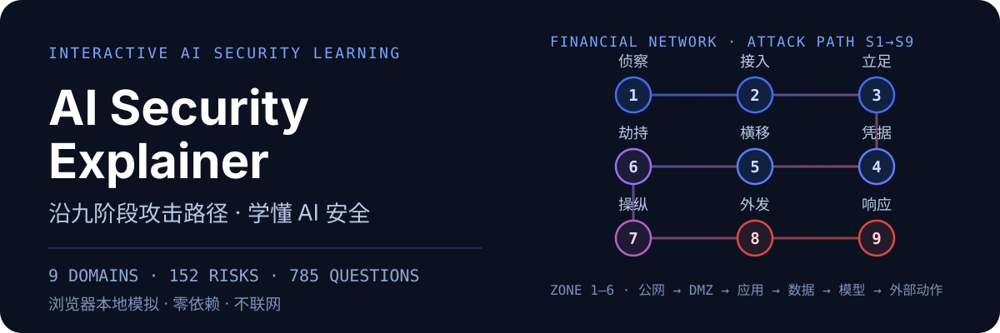
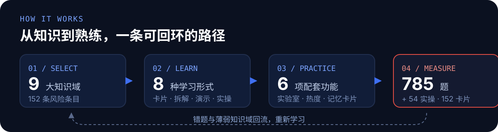

<p align="center">
  
</p>

<p align="center">
  <strong>交互式 AI 安全学习站 · 面向零基础读者</strong><br />
  在一张模拟的金融企业网络拓扑上，沿九阶段攻击路径（S1~S9）逐跳学习 AI 安全知识与 OWASP 系列风险清单。<br />
  当前版本 <a href="https://github.com/anyeduke11/AI-Security-explainer/releases/tag/v0.1.0">v0.1.0 · 首个公开预览版</a>
</p>

所有演示均为**浏览器本地规则化模拟**：不联网、不执行用户输入、不存储任何提交内容，仅用于防御性学习。

---

## 快速开始

零依赖、无构建步骤。

```bash
# 方式一：直接在浏览器打开 index.html（file:// 协议下全部功能可用）
# 方式二：用固定端口脚本启动（推荐）
./scripts/serve.sh start     # 启动；已运行则直接返回，不会重复起实例
./scripts/serve.sh status    # 查看状态
./scripts/serve.sh restart   # 重启
./scripts/serve.sh stop      # 停止
# 然后打开 http://127.0.0.1:8899/index.html
```

> 站点端口固定为 **8899**。测试脚本均按此地址访问；若被占用，脚本会拒绝启动并报错，不会自动换端口。

---

## 学习闭环

<p align="center">
  
</p>

### 八种学习形式

1. **知识学习卡片** — 掌握等级、来源依据、交叉引用快捷入口
2. **30 秒读懂** — 一句话定义 + 风险说明 + 打个比方
3. **原理拆解** — 4~6 步机制拆解，含补充细节
4. **动手试一试** — 11 类交互引擎 + 152 条靶场剧本（本地模拟）
5. **如何防护** — 输入侧 / 系统侧 / 出口侧三层控制
6. **典型场景分析** — 案例 → 影响链路 → 治理 → 辨析
7. **随堂小测** — 随堂题 + 测验中心按知识域/难度组卷
8. **实操题** — 54 道（九域各 6 道），配置终态 / 有序步骤 / 产物清单三种形式，关键项与终态部分得分

### 六项配套功能

- **攻击路径实验室** — 网络拓扑 / 攻击时间轴 / 防御滑块 / 阶段热度矩阵
- **风险热度** — 阶段 × 知识域 9×9 矩阵，点击联动筛选
- **新手学习路径** — 7 阶段 44 步，从基础到合规逐层深入
- **测验中心** — 785 道单选题 + 54 道实操题，支持知识域、难度、题型、错题筛选
- **知识卡片** — 独立「记忆」菜单，152 张内置卡片 + 用户自建，完整 SM-2 间隔重复
- **我的学习进度** — 本地记录、掌握等级分布、记忆与实操维度、导出备份

---

## 内容概览

### 九大知识域

| 知识域 | 内容 | 风险条目 |
|---|---|---|
| AI 与安全基础 | AI/ML/DL 原理、Transformer、训练微调、安全属性与威胁模型 | 10 |
| LLM 应用 | 提示注入、越狱、幻觉、RAG、内容安全与防护 | 42 |
| MCP 工具层 | 工具调用协议、权限模型、信任链与审计 | 18 |
| 智能体应用 | ReAct 架构、目标劫持、人机回环 | 15 |
| 智能体技能 | 技能供应链、物料清单、安装授权 | 14 |
| Web 安全 | 注入、XSS、CSRF 等应用漏洞 | 12 |
| 基础设施 | 容器、镜像、密钥、日志与应急响应 | 21 |
| 社会与安全影响 | 社会、经济、关键基础设施与军事影响链路 | 10 |
| 合规与治理 | 国家战略、法规政策、标准规范与评估报告 | 10 |

共 **152 条风险条目**；统一「AI安全题库」共 **785 道单选题**（152 条风险随堂题 + 633 道扩展题）；另有 **54 道实操题**（九域各 6 道）、**152 张内置知识卡片**（支持自建）。

---

## 目录结构

```
index.html                          主站入口（hash 路由 SPA）
assets/
  readme/hero.svg                   README 项目原生主视觉
  readme/workflow.svg               README 学习闭环图
  css/style.css                     全站样式（含术语悬浮卡、知识卡片）
  js/data.js        ★ 知识库唯一数据源：CATS / RISKS / ZONES / STAGES / PATHS / SCRIPTS / GLOSSARY
  js/ai-bank.js                     ★ 生成物：扩展题库 633 题（九域，Q001~Q633）
  js/cards.js                       ★ 知识卡片数据层与完整 SM-2 算法
  js/practical.js                   ★ 54 道实操题（九域全量）与本地判分器
  js/glossary.js                    术语悬浮卡
  js/demos.js                       11 类交互演示引擎（含 concept/policy/impact）
  js/lab.js                         攻击路径实验室（拓扑 / 时间轴 / 热度矩阵）
  js/app.js                         路由 / 搜索 / 测验 / 卡片复习 / 进度
demos/
  transformer-attack-explainer.html Transformer 攻防透视（可独立打开）
docs/
  六大知识域完善方案.md             知识整合方案与验收要求
scripts/
  serve.sh                          固定端口 8899 启动脚本
  extract-bank.mjs                  从原始题库 HTML 提取 BANK（需外部源文件）
  transform.mjs / synonyms.mjs      题干同义改写与选项随机化
  gen-ai-bank.mjs                   生成 ai-bank.js
  enrich-risks.mjs / update-risk-text.mjs  描述丰富与回写工具
  e2e-ai-quiz.mjs                   CDP 端到端验证（题库）
  e2e-cards-practical.mjs           CDP 端到端验证（卡片 + 实操）
tests/
  logic / interaction / persistence / ai-bank.test.mjs   三层 TDD + 题库 TDD
  cards.test.mjs                    卡片字段与完整 SM-2 算法 TDD
  practical.test.mjs                实操题完整性与判分器 TDD
  glossary / demos / lab.test.mjs   术语 / 引擎 / 攻击路径状态机 TDD
LICENSE                             知识共享署名-非商业性使用-相同方式共享 4.0
ABOUT.md                            项目定位、作者与授权说明
```

---

## 数据模型纪律

`assets/js/data.js` 是**唯一数据源**。新增知识域或风险条目时，必须同步：

- `CATS` / `RISKS` / `RISK_STAGES` / `ZONES[].codes` / `STAGES[].codes`
- `PATHS` / `SCRIPTS` / `GLOSSARY[].see`
- `scripts/gen-ai-bank.mjs` 的 `DOMAINS` 并重跑生成 `ai-bank.js`
- 测试断言与 `index.html` 版本号

`ai-bank.js` 是生成物，**不要手改**，应修改生成器后重跑。

---

## 测试

```bash
node tests/logic.test.mjs          # 数据完整性与逻辑
node tests/ai-bank.test.mjs        # 题库等价性、去重、九域一致性
node tests/cards.test.mjs          # 卡片字段与完整 SM-2（1/6/interval×EF、EF≥1.3）
node tests/practical.test.mjs      # 实操题完整性与判分器（部分得分、顺序、禁用项）
node tests/glossary.test.mjs       # 术语匹配、优先级与转义
node tests/demos.test.mjs          # 11 类引擎分派与纯 UI 函数
node tests/lab.test.mjs            # 攻击路径状态机与阻断判定
node scripts/e2e-ai-quiz.mjs       # 题库端到端（需 Chrome CDP 9223 + 站点 8899）
node scripts/e2e-cards-practical.mjs  # 卡片 + 实操端到端
```

> 全量 9 个测试文件当前全部通过（含 CDP 端到端）；此前识别的 C3 / D3 / F5 等待改进项已修复。

---

## 许可证与商用授权

本项目采用 [CC BY-NC-SA 4.0](LICENSE) 许可：

- **允许**：非商业用途下的复制、分享、改编，须署名并以相同方式共享；
- **禁止**：未经授权的**商业使用**（包括但不限于企业内训、商业产品集成、付费课程、咨询服务）；
- **商用授权**：请联系仓库维护者获取书面许可，详见 [ABOUT.md](ABOUT.md)。

---

## 致谢

内容依据公开安全框架与课程资料整理，演示均为教学模拟，不构成安全产品或法律意见。
